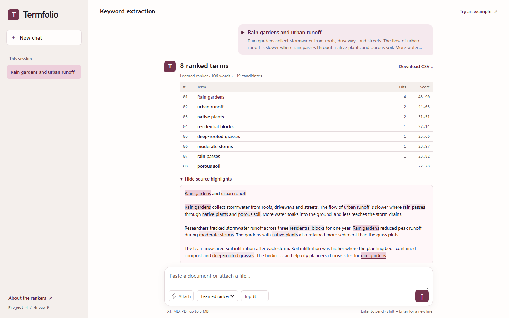

# Termfolio

Termfolio extracts keywords and keyphrases from English documents.
Paste text or attach a file, choose a ranking method and send it in the chat.
Each reply keeps its own ranked list, source highlights and CSV download.

Project 4, Keyword and Keyphrase Extraction · NLP capstone · Group 9

## Run locally

Use Python 3.11 or newer.

```powershell
python -m pip install -r requirements.txt
python app.py
```

Open [Termfolio](http://127.0.0.1:8000) in your browser.
The rain gardens example runs when the page opens.
Use `python app.py --port 8001` if port 8000 is busy.
Press `Ctrl+C` in the terminal to stop the server.

The included model and statistics are loaded from `artifacts/`.
The app runs offline after dependencies are installed.
Chats and drafts stay in browser memory for the current page session and clear on reload.
It accepts UTF-8 TXT and Markdown, and PDFs with selectable text.
Uploads are limited to 5 MB, PDFs to 40 pages, and extraction to 60,000 characters.

## Retrain and evaluate

```powershell
python train.py
```

The command reads the original Inspec splits from `data/Hulth2003.tar.gz`, trains the ranker and writes `artifacts/model.json` and `artifacts/evaluation.json`.
Restart the app to load newly generated files.
The ranking and evaluation use the same candidate generator.

| Method | Precision@10 | Recall@10 | F1@10 |
| --- | ---: | ---: | ---: |
| Learned ranker | 0.320 | 0.370 | 0.323 |
| TF-IDF | 0.139 | 0.178 | 0.146 |
| RAKE | 0.128 | 0.162 | 0.134 |

These are macro-averages over 500 held-out research abstracts, using normalized exact phrase matches.
The [project report](docs/report.md) includes the full test table, design decisions, limitations and demo steps.
The [analysis notebook](analysis/inspec.ipynb) shows the length distributions and both evaluation cutoffs.

## Browser checks

With the app running, use a local Node.js environment that can resolve `playwright`.
Set `TERMFOLIO_CHROMIUM` to an installed Chromium executable if the Playwright browser binaries are unavailable.
Set `TERMFOLIO_URL` if using a different port.

```powershell
node tests/browser.cjs
```

The script opens headless Chromium and checks chat history, draft recovery, extraction, method and count controls, highlights, CSV export, supported uploads, error states and the mobile layout.
It writes images to `docs/screenshots/`.



## Group 9

| Name | Roll number |
| --- | --- |
| Shreyansh Vaibhav | 2401201094 |
| Harsh Nagal | 2401201089 |
| Dipesh Singh | 2401201091 |
| Tanish Sabharwal | 2401201096 |

## Dataset acknowledgement

Data from the Inspec Database kindly supplied by The IET.
The archive permits research use with acknowledgement.
[Original paper](https://aclanthology.org/W03-1028/) · [Benchmark archive source](https://github.com/snkim/AutomaticKeyphraseExtraction)
