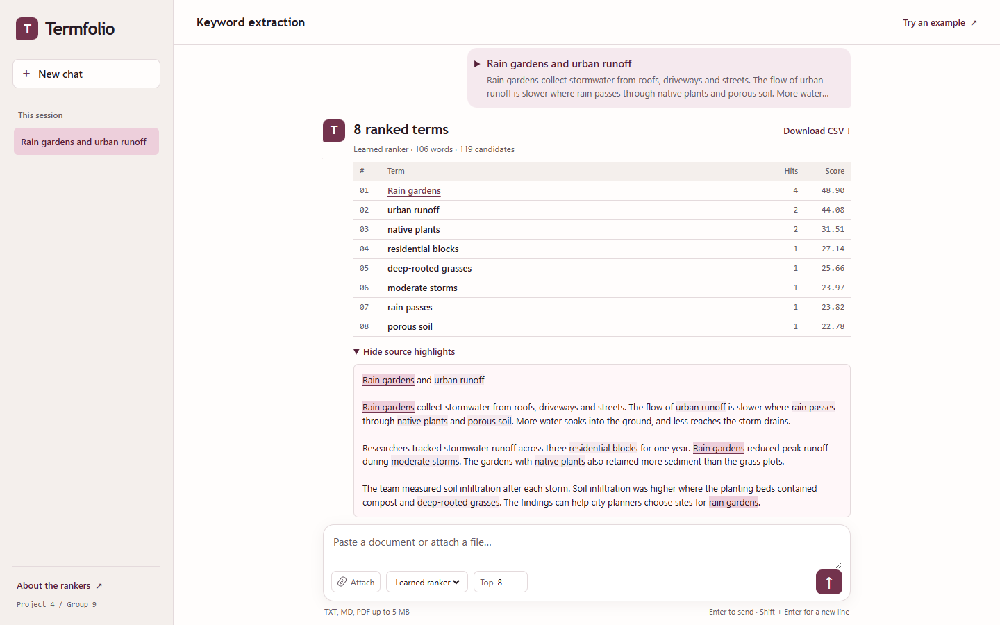

# Keyword and keyphrase extraction

**Termfolio · NLP capstone Project 4 · Group 9**

| Name | Roll number |
| --- | --- |
| Shreyansh Vaibhav | 2401201094 |
| Tushar Kataria | 2401201083 |
| Nandini Kumari | 2401201085 |
| Harsh Nagal | 2401201089 |
| Dipesh Singh | 2401201091 |
| Tanish Sabharwal | 2401201096 |

## Problem and objective

Readers often need a short index before they can sort through a pile of abstracts or reports.
Termfolio ranks the important words and phrases in a document and shows where each appears.
Possible uses include literature review, document tagging and search metadata.

## Dataset and exploratory analysis

The Inspec benchmark contains titles and abstracts of 2,000 English scientific publications.
The project uses the original split and the uncontrolled keyphrases assigned by human indexers.
Data from the Inspec Database kindly supplied by The IET. [Hulth, 2003](https://aclanthology.org/W03-1028/) · [Archive mirror](https://github.com/snkim/AutomaticKeyphraseExtraction)

| Split | Documents | Median tokens per document | Mean gold terms | Gold in candidate set |
| --- | ---: | ---: | ---: | ---: |
| Training | 1,000 | 124 | 9.79 | 71.97% |
| Validation | 500 | 114.5 | 9.15 | 70.45% |
| Test | 500 | 122 | 9.83 | 72.44% |

After cleaning, 1,775 of the 2,000 documents contained fewer than 200 tokens.
Two-word phrases made up 9,856 of the 19,274 references, about 51%.
Candidate coverage is the share of all gold annotations that the generator can produce before ranking.
The exact counts and both distributions are available in [evaluation.json](../artifacts/evaluation.json).
The presentation plots the reference-length distribution.

## Cleaning and candidate generation

The loader decodes UTF-8 with a Latin-1 fallback, normalizes Unicode and rejoins indented line wraps.
It rejects empty text or labels and checks duplicates in train, validation and test order.
The archive yielded zero missing or duplicate records under these rules.

The extractor tokenizes Unicode words, preserves internal hyphens and normalizes case and possessives for matching.
It generates contiguous spans of one to four words without crossing punctuation or line boundaries.
Stopwords are excluded at the edges, with a small set of permitted connectors inside phrases.
Each candidate retains its original spelling and character positions for highlighting.
There is no stemming or synonym matching in the evaluation.

## Ranking methods

- **TF-IDF.** Multiply log-scaled term frequency by smoothed inverse document frequency from the training split. Terms seen in fewer than two training documents share the same IDF. [Manning, Raghavan and Schütze](https://nlp.stanford.edu/IR-book/html/htmledition/tf-idf-weighting-1.html)
- **RAKE.** Score each content word by degree divided by frequency in runs between stopwords and punctuation. Sum the scores over each candidate. This baseline uses the common candidate set, which makes the ranking comparison more direct. [Rose et al., 2010](https://doi.org/10.1002/9780470689646.ch1)
- **Learned ranker.** Fit regularized logistic regression on 13 standardized features, including frequency, first position, title match, phrase length, word length, IDF, RAKE score and whether a candidate is contained in a longer phrase. A candidate is positive if its normalized text matches an indexer's reference.

The model learned from 104,006 training candidates, including 7,043 positives.
Training used shuffled minibatches with seed 42 and L2 regularization.
The run selected epoch 20 by validation macro F1@10, which reached 0.326.
The web server loads these coefficients once and uses them to rank new input locally.

## Held-out evaluation

Each method ranked the same candidates on 500 test abstracts.
Precision is the fraction of returned terms that match a reference.
Recall is the fraction of references retrieved, and F1 is their harmonic mean.
Compute each metric per document and then average across documents.

| Method | Top k | Precision | Recall | F1 |
| --- | ---: | ---: | ---: | ---: |
| Learned ranker | 5 | 0.401 | 0.243 | 0.284 |
| TF-IDF | 5 | 0.162 | 0.104 | 0.119 |
| RAKE | 5 | 0.140 | 0.090 | 0.102 |
| Learned ranker | 10 | 0.320 | 0.370 | 0.323 |
| TF-IDF | 10 | 0.139 | 0.178 | 0.146 |
| RAKE | 10 | 0.128 | 0.162 | 0.134 |

The learned ranker scored best at both cutoffs.
Going from five to ten results increased recall while lowering precision.
Some gold phrases do not occur verbatim in the source or fall outside the candidate rules.
The model was trained on scientific abstracts, so its quality on other writing styles remains unmeasured.

## Application and live demo

The chat sends each document to a Python server bound to the local machine.
The server returns ranked terms and their original character spans.
Each reply displays those terms and lets the reader highlight the source or download the list as CSV.
The browser holds conversations and drafts in memory for the current page session.

1. Run `python app.py` and open `http://127.0.0.1:8000`.
2. Start with the rain gardens example, or open a new chat and paste an abstract.
3. Choose a method, set **Top** and send the document.
4. Select a row such as **Rain gardens** to see its matches in the source.
5. Send the same text with a different method to compare replies, then download the CSV.

The desktop and mobile browser checks covered all three ranking methods, result count, term highlights, CSV download, TXT, Markdown and PDF uploads, and empty, stopword-only and malformed inputs.

## Follow-up work

Part-of-speech tagging could remove fragments that include verbs at phrase boundaries.
Normalization for plural and singular forms would give a clearer view of errors made by exact matching.
Testing on reports, news and student notes would measure how far the Inspec-trained model transfers.
